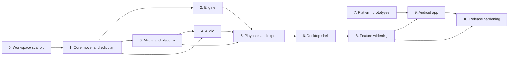

# MovieMaker — Implementation Roadmap

**Status:** In progress · 24 November 2026

This is the overall implementation plan. It orders the work into phases, links the detailed design
document for each phase, and records where the whole effort stands. It sets an order of work, not
release priorities (specification §9). The [architecture](../moviemaker-architecture.md) describes
the intended structure. This document and the phase documents describe the work and its progress.

## 1. How to use these documents

- **This roadmap** is the entry point. Its progress table (§3) shows the status of each phase and
  links to its design document.
- **Each phase document** holds the stages, exit criteria, decisions, open questions, a stage log,
  and a **handoff** block that says what the next session reads first and does next.
- **The Planner keeps them true** in the same change as the work they describe
  ([architecture-docs instructions](../../.github/instructions/architecture-docs.instructions.md)).
  A stage is marked Complete only when every exit criterion has been checked against the
  repository.

### Starting or resuming work

Each request names a stage. Do not just say "start implementation". Examples:

- *"Orchestrator: start Phase 0 stage 0.1 from docs/design/phase-0-workspace-scaffold.md."*
- *"Orchestrator: continue the walking skeleton from the handoff in the current phase document."*
- *"Planner: refine the stages of docs/design/phase-3-media-and-platform.md before we start it."*

The Orchestrator asks the Planner for a file-level plan of that stage, then runs Coder, Designer,
verification, documentation, and review (see the [Orchestrator](../../.github/agents/orchestrator.agent.md)).
Work small enough for one package or one file can be done directly, without orchestration.

Before a stage starts, its open questions marked **Blocks** must be answered, and any approval that
AGENTS.md *What to ask before doing* requires must be given.

## 2. Phase overview

- **Phases 0–6 are the walking skeleton** (architecture §16). Its scope is fixed there. Phases 2–5
  run in the playground, and Phase 6 brings the result into Electron.
- **Phase 7 has no prerequisite.** Its prototypes are standalone projects under `prototypes/`, outside
  the workspace, so they do not need Phase 0. It runs first because it tests the riskiest
  assumptions: stage 7.1 must pass before Phase 5 relies on WebCodecs H.264 and AAC encoding in
  Electron, and the Android results decide the Android decision gate (architecture §15).
- **Phase 8 widens the feature set** on desktop, one track at a time.
- **Phase 9 starts only after the Android gate is settled.**

## 3. Progress

| Phase | Document | Status | Milestone |
|---|---|---|---|
| 0 | [Workspace scaffold](phase-0-workspace-scaffold.md) | Complete (2026-11-27) | Walking skeleton |
| 1 | [Core model and edit plan](phase-1-core-model.md) | Not started | Walking skeleton |
| 2 | [Engine](phase-2-engine.md) | Not started | Walking skeleton |
| 3 | [Media and platform](phase-3-media-and-platform.md) | Not started | Walking skeleton |
| 4 | [Audio](phase-4-audio.md) | Not started | Walking skeleton |
| 5 | [Playback and export](phase-5-playback-and-export.md) | Not started | Walking skeleton |
| 6 | [Desktop shell](phase-6-desktop-shell.md) | Not started | Walking skeleton |
| 7 | [Platform prototypes](phase-7-platform-prototypes.md) | In progress | Android decision gate (passed 2026-11-26) |
| 8 | [Feature widening](phase-8-feature-widening.md) | Not started | Desktop feature set |
| 9 | [Android app](phase-9-android-app.md) | Not started | Android app |
| 10 | [Release hardening](phase-10-release-hardening.md) | Not started | First release |

Statuses: Not started, In progress, Complete, Paused.

## 4. Milestones

| Milestone | Reached when |
|---|---|
| **Walking skeleton** | Phase 6 exit criteria hold: on desktop, a project with photo and video clips, a crossfade, one Pan & Zoom preset, and one music track previews in sync, saves, reopens, undoes, and exports to MP4 (H.264 and AAC) that matches the preview in content and timing. |
| **Android decision gate** | Every Android prototype in Phase 7 has a recorded result and the gate outcome is recorded in an ADR when the native engine fallback is chosen. **Reached 2026-11-26:** passed, no fallback. |
| **Desktop feature set** | The Phase 8 tracks chosen for the first release are complete. |
| **Android app** | Phase 9 exit criteria hold on the device matrix. |
| **First release** | Phase 10 exit criteria hold. |

## 5. Rules for every phase

These come from AGENTS.md *Conventions*. They are repeated here because every phase plan is checked
against them.

- `core` stays pure: no DOM, no platform API, no other package.
- Every edit is one command, and one gesture or compound operation is one undo step.
- Preview and export consume only the edit plan and share `renderFrame` and the mixer
  ([ADR-0002](../adrs/0002-edit-plan-shared-by-preview-and-export.md),
  [ADR-0008](../adrs/0008-shared-audio-mixer-with-prepared-pcm.md)).
- Time is integer microseconds; ranges are `[in, out)`; frame rates are rationals
  ([ADR-0003](../adrs/0003-integer-microsecond-time-and-derived-sequence-timing.md)).
- Presets are versioned data with no JavaScript
  ([ADR-0007](../adrs/0007-webgl2-renderer-with-data-only-presets.md)).
- A project model change bumps `schemaVersion` and adds a tested migration.
- No GPL; LGPL only as a separate process or replaceable module
  ([ADR-0006](../adrs/0006-licensing-policy-for-dependencies.md)).
- A change that hits an architecture trigger updates the architecture in the same change.

## 6. Approvals needed, by phase

Each item needs the user's approval before the phase that introduces it (AGENTS.md *What to ask
before doing*). Licence checks follow ADR-0006. Once approved, a third-party package that package or
app code imports is also added to that file group's import allowlist in `eslint.config.js`
(architecture §4); until then `pnpm lint` fails.

| Phase | Approval |
|---|---|
| 0 | Tooling dependencies: pnpm, TypeScript, Vite, Vitest, Playwright, a lint tool (ESLint with typescript-eslint, and Prettier), `@types/node`, and `@eslint/js`. All approved; `@types/node` and `@eslint/js` on 2026-11-26 (Phase 0 Q0.7). |
| 1 | Zod; the first project file schema (`schemaVersion` 1) |
| 2 | React (or none) for the playground UI |
| 3 | TypeScript signatures of the platform adapter interfaces (Phase 3 Q3.2). Mediabunny approved on 2026-11-26 (Phase 3 Q3.1). |
| 4 | A resampler (library or in-house) |
| 5 | Zustand and Immer |
| 6 | Electron, electron-builder; every Electron IPC channel |
| 7 | Capacitor for the Android prototype app; prototype pass criteria (confirmed before running) |
| 8 | Signalsmith Stretch, OpenCV.js, libheif, the FFmpeg build; each new preset family; each schema change |
| 9 | Capacitor plugins; every Android permission |
| 10 | Signing and distribution choices |

## 7. Open product decisions, by phase

These are specification §9 decisions. The user decides them; the phase that needs one lists it as a
blocking open question.

| Decision (specification §9) | First needed in |
|---|---|
| Opening background colour choice | Phase 1 uses the model's `canvas.background`; the UI choice is Phase 8 |
| Automatic Pan & Zoom behaviour | Phase 8, Pan & Zoom track |
| Fit to Music margin, text clips, impossible fit | Phase 8, Fit to Music track |
| Slow, Medium, Fast audio fade lengths | Phase 8, video editing track |
| Default ducking amount and ramps | Phase 8, audio track |
| Caption styling, text presets, second Cinematic Burst | Phase 8, text track |
| Custom aspect ratio input | Phase 8, project settings |
| Release scope | Phase 10 |

## 8. Stage log

| Date | Change |
|---|---|
| 2026-11-24 | Roadmap and phase documents created. No phase started. |
| 2026-11-26 | Phase 7 In progress. Stage 7.1 passes on Windows; the Android gate (7.12) passed and the shared engine stays in the WebView. |
| 2026-11-26 | Phase 0 In progress: the workspace scaffold and its gate are in place; stage 0.1 waits only for approval of `@types/node` (Phase 0 Q0.7). |
| 2026-11-26 | Phase 0 remediation round 1: stage 0.3 reopened until its dependency-rule checks are reproduced independently; Q0.7 also covers `@eslint/js`; Q0.10 and Q0.11 opened. |
| 2026-11-26 | Phase 0 remediation round 2: the dependency rule is now an exact import allowlist, third-party imports included, with a regression suite in `pnpm test`; stage 0.3 stays In progress until the suite passes in a gate run and someone other than the Coder reproduces the violating imports. |
| 2026-11-26 | Phase 0 stage 0.3 Complete: the Reviewer ran `pnpm typecheck`, `pnpm lint`, and `pnpm test` and reproduced the violating imports by hand, all blocked. Known enforcement limits recorded in architecture §4; Phase 0 Q0.12 opened on two of them. Phase 0 stays In progress for stage 0.1 (Q0.7). |
| 2026-11-26 | Phase 0 Q0.7 to Q0.12 answered with the recommendations: `@types/node` and `@eslint/js` approved, the dependency rules settled (architecture §3 and §4), and the two enforcement gaps of Q0.12 closed by the Coder (reported gate passing, not yet confirmed independently). Phase 0 stays In progress: stage 0.1 waits for the first commit and a check from a real clone. Phase 0 Q0.13 opened on an indirect route around the new entry-point check. |
| 2026-11-26 | Phase 0 round 3 review: the Reviewer ran all six gate commands independently (all pass) and kept stage 0.3 Complete; the nested-configuration test was fixed for letter case (Coder's gate after the fix passes, not yet confirmed independently); Phase 0 Q0.13 reproduced on two routes and still open. Roadmap §6: Mediabunny marked approved (Phase 3 Q3.1). Phase 0 stays In progress for the commit and the clean-clone check. |
| 2026-11-27 | Phase 0 Q0.13 resolved (accepted 2026-11-26) and implemented by the Coder, uncommitted: package source imports by path only inside its `src/`, closing the indirect routes around the entry-point check before Phase 2 stage 2.3 and Phase 3 stage 3.1 (Coder's gate passing, not yet confirmed independently). Phase 0 Q0.14 opened on the part of that change that goes beyond the recommendation; it blocks nothing. The scaffold is committed (`cf8b8e8`); Phase 0 stays In progress until the commit with the Q0.13 change passes the clean-clone check. |
| 2026-11-27 | **Phase 0 Complete.** The Q0.13 change is committed (`dc5170a`), and the Reviewer's check from a real clone of `29483d4` passed: `pnpm install` and all six gate commands exit 0, which closes stage 0.1 and confirms the gate and Q0.13 independently. Phase 0 Q0.15 opened (configuration can redirect an entry point; recommended test before Phase 2 stage 2.3 and Phase 3 stage 3.1) and Q0.16 (dates in the records). Phase 0 Q0.14 to Q0.16 and its Appendix A await the user and do not block Phase 1. Phase 1 is next. |

## 9. Handoff

- **Read first:** this roadmap, then [Phase 1](phase-1-core-model.md) and
  [Phase 7](phase-7-platform-prototypes.md); [Phase 0](phase-0-workspace-scaffold.md) §5 and §7
  for its open items.
- **Do next:** Phase 0 is complete. Start Phase 1 from its handoff: answer Q1.1 to Q1.5, then
  stage 1.1. Phase 0 Q0.14 to Q0.16 and the agent-file correction in its Appendix A await the
  user and do not block Phase 1; Phase 0 Q0.15 is to be answered before Phase 2 stage 2.3 and
  Phase 3 stage 3.1. Phase 7 is under way: stage 7.1 passes on Windows, the Android gate has
  passed, and the open items are listed in the Phase 7 handoff.
