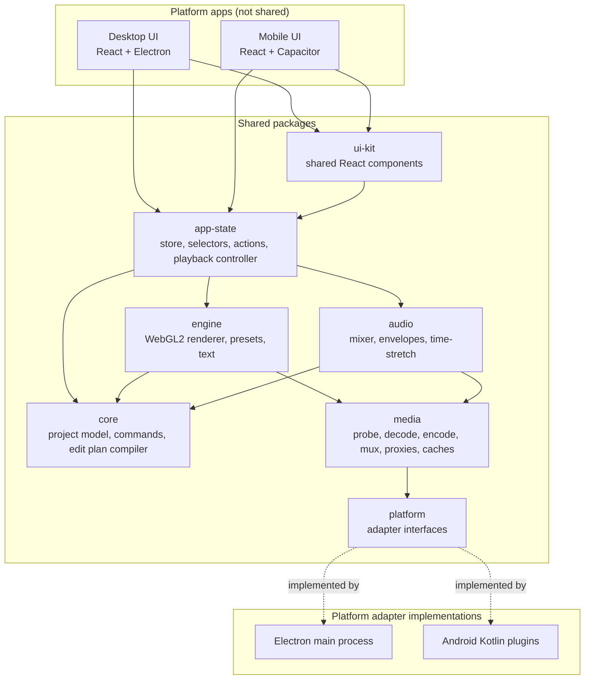
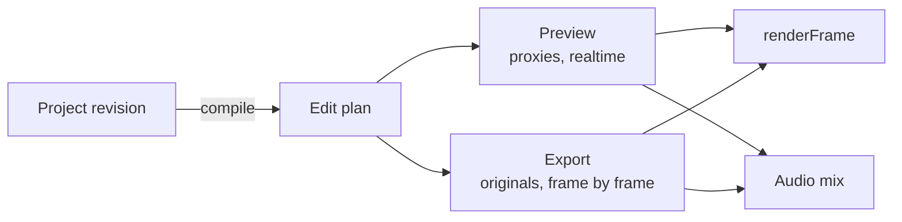
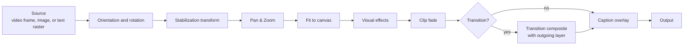
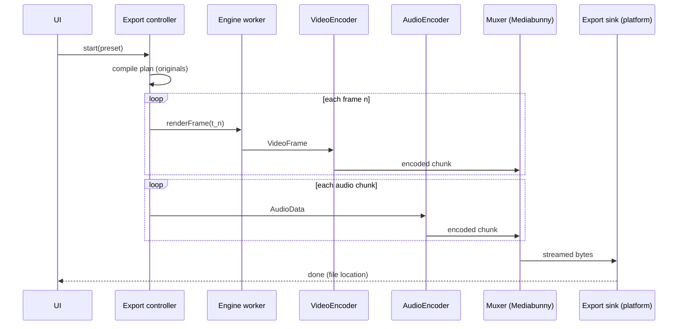

# MovieMaker — Architecture

**Status:** Draft · 23 November 2026

This document describes the technical architecture of the intended MovieMaker product on desktop and Android. It implements the capabilities in the [functional specification](moviemaker-functional-specification.md) and uses the terms defined in the [glossary](moviemaker-glossary.md). Release priorities are out of scope. Section 15 lists the risks that early prototypes must validate, and section 16 defines the first end-to-end build.

## 1. Goals and constraints

| Goal | Consequence for the architecture |
|---|---|
| Desktop (Windows, macOS, Linux) and Android. iOS possible later. | One TypeScript codebase for the engine, hosted by Electron on desktop and Capacitor on Android. Capacitor keeps iOS open. Android keeps a native engine as a fallback (section 13.3). |
| Offline only | All decoding, rendering, encoding, and analysis run on the device. No server components. |
| Preview matches export | Preview and export call the same renderer and the same audio mixer with the same edit plan. Preview uses proxies, so the match is in content and timing, not pixel for pixel. |
| Projects move between devices | The project model is resolution-independent, references assets by content fingerprint, and uses bundled fonts and stable preset IDs. |
| Separate desktop and mobile UIs | UIs are separate React apps. The project model, state store, engine, and media layers are shared. |
| Personal and learning project that may become open source | Prefer permissively licensed dependencies. Avoid GPL components. LGPL components run as separate processes or replaceable modules. |

## 2. Technology choices

| Concern | Choice | Notes |
|---|---|---|
| Language | TypeScript (strict) | Kotlin for Android plugins only. |
| UI | React | One React app per platform. |
| State | Framework-agnostic store (for example Zustand) with immutable updates (for example Immer) | Shared by both UIs. |
| Desktop shell | Electron | Ships its own Chromium, so WebCodecs, WebGL2, and OffscreenCanvas behave consistently on every desktop OS. |
| Android shell | Capacitor | Uses the system Android WebView (Chromium). Native features are Kotlin plugins. |
| Rendering | WebGL2 behind a backend interface | A WebGPU backend can be added later without changing the engine API. Presets are GLSL ES 3.00 and data, so a native OpenGL ES renderer can reuse them (section 8.4). |
| Video and audio codecs | WebCodecs (`VideoDecoder`, `VideoEncoder`, `AudioDecoder`, `AudioEncoder`) | Hardware-accelerated where the platform provides it. On desktop, an FFmpeg sidecar covers missing decoders and encoders (section 11). |
| Demux and mux | Mediabunny | MP4 and WebM read and write, including streaming output. MPL-2.0, a file-level copyleft that fits the licensing goal. |
| Audio | One mixer in TypeScript (WASM if needed), run in an `AudioWorklet` for preview and in a worker for export | Web Audio provides only the output and the preview clock (section 10). |
| Time-stretch (pitch preservation) | Signalsmith Stretch (WASM) | MIT licence. |
| Motion analysis (stabilization) | OpenCV.js (WASM) in a worker | Used only by the stabilization analysis job. |
| HEIC decoding | libheif compiled to WASM on desktop, `ImageDecoder` on Android | libheif and libde265 are LGPL and ship as a replaceable module. |
| Build | pnpm workspaces and Vite | |
| Tests | Vitest and Playwright | |

**Alternatives considered**

- **Tauri** uses the system webview. WebKitGTK on Linux has no WebCodecs and macOS WebKit support is partial, so the shared renderer could not run everywhere.
- **A native core in Rust or C++ with FFmpeg** would perform better but requires cross-compiling, N-API and JNI bindings, and FFmpeg licensing work. Section 11 uses an FFmpeg sidecar on desktop only for sources and codecs that WebCodecs cannot handle.
- **Flutter** would share the UI, which is not a goal here, and still requires native media code on each platform.
- **A native Android engine** (Media3 Transformer and Composition with OpenGL ES effects) would avoid WebView limits but needs its own renderer. It remains the fallback if the Android prototypes fail (section 13.3).
- **A web app (PWA) only** would avoid installers, but file access and codec support vary by browser. The playground can still be published as a Chromium-only web version (section 13.1).

## 3. System overview



### Data flow



The project is the editable document. Every change produces a new **project revision**. A pure compiler turns each revision into an **edit plan**. Preview and export consume only edit plans. They never interpret the project directly.

## 4. Repository structure

```
easy-movie-maker/
├─ docs/
├─ packages/
│  ├─ core/         # model, schema, migrations, commands, timing, Fit to Music, edit plan
│  ├─ app-state/    # store, selectors, actions, playback and export controllers
│  ├─ ui-kit/       # React components shared by both apps (thumbnails, waveforms, preset grids, property controls)
│  ├─ engine/       # renderer, generic render passes, preset catalog, text layout
│  ├─ audio/        # shared mixer, AudioWorklet host, envelopes, resampling, time-stretch
│  ├─ media/        # probing, decode and encode pools, muxing, proxies, intermediates, thumbnails, waveforms
│  ├─ platform/     # adapter interfaces and a browser implementation for the playground
│  └─ fonts/        # bundled open-licensed font files and font catalog
├─ apps/
│  ├─ playground/   # browser app for engine development and golden-frame tests, optionally published as a web version
│  ├─ desktop/      # Electron main, preload, and React renderer
│  └─ mobile/       # Capacitor project, React app, Kotlin plugins
```

**Dependency rules**

- `core` has no runtime dependencies on other packages, the DOM, or platform APIs.
- `engine`, `audio`, and `media` depend on `core` and on `platform` interfaces, never on implementations.
- `ui-kit` depends on `app-state` and on preset catalog metadata from `engine`. It holds no app layout.
- Apps inject platform implementations at startup.
- Presets have a single catalog in `engine`. It provides metadata such as ID, display name, family, parameter schema, and thumbnail to the UIs, and preset programs to the renderer.

## 5. Project model

### 5.1 Time and space

- **Time** is stored as integer microseconds, which matches WebCodecs timestamps and avoids floating-point drift. Ranges follow the glossary convention `[in, out)`.
- **Frame rates** are rationals (`{ num: 30000, den: 1001 }`). Export frame *n* is at `round(n × 1 000 000 × den / num)` µs.
- **Effective duration** of a video clip is `round((out − in) / speed)`. One function in `core` computes it and the source-time mapping, so every package rounds the same way.
- **Canvas positions** (text boxes, caption placement) are normalized to the output canvas (0–1). Font sizes are relative to canvas height.
- **Pan & Zoom rectangles** are normalized to the rotated source image.
- The project stores the **aspect ratio** (16:9, 4:3, or custom), not a pixel resolution. Resolution belongs to the export preset.

### 5.2 Entities

```ts
type Micros = number; // integer microseconds

interface Project {
  schemaVersion: number;
  id: string;
  name: string;
  canvas: { aspect: { w: number; h: number }; background: 'black' | 'white' };
  defaultFit: MediaFit;     // initially 'fit'
  assets: Record<AssetId, Asset>;
  sequence: VisualClip[];   // the main visual edit, adjacent clips
  captions: Caption[];      // single caption track, no overlaps, soft-anchored to clips
  music: MusicTrack[];          // one or more music tracks
  narration: NarrationTrack;    // single narration track, soft-anchored to clips
  ducking: { enabled: boolean; amount: number };  // music level while narration plays, 0–1
}

type VisualClip = PhotoClip | VideoClip | TextClip;

interface VisualClipBase {
  id: ClipId;
  transitionIn?: PresetRef & { duration: Micros };  // overlaps the end of the preceding clip
  effects: PresetRef[];                              // stacked visual effects, applied in order
  entryFade?: PresetRef;                             // picture fade presets
  exitFade?: PresetRef;
}

interface PhotoClip extends VisualClipBase {
  kind: 'photo'; assetId: AssetId; duration: Micros;
  rotation: 0 | 90 | 180 | 270;
  fit?: MediaFit;                                           // absent: project default
  panZoom?: { presetId: string; start: Rect; end: Rect };  // resolved rectangles
}

interface VideoClip extends VisualClipBase {
  kind: 'video'; assetId: AssetId;
  in: Micros; out: Micros;             // source range
  speed: number;                       // effective duration = round((out - in) / speed)
  pitch: 'preserve' | 'shift';
  audioEnabled: boolean;
  volume: number;                      // embedded audio, 0–2, 1 = unchanged
  audioFadeIn: AudioFade; audioFadeOut: AudioFade;  // embedded audio only
  rotation: 0 | 90 | 180 | 270;
  fit?: MediaFit;
  stabilization?: { enabled: boolean; strength: number };
}

interface TextClip extends VisualClipBase {
  kind: 'text'; duration: Micros; background: Color; text: TextBlock;
}

interface Caption {
  id: string;
  anchorClipId: ClipId;   // timeline start = start(anchor) + offset
  offset: Micros;         // 0 ≤ offset < duration(anchor)
  duration: Micros;       // may extend past the anchor clip
  text: TextBlock;
}

interface TextBlock {
  content: string; fontId: string; size: number; color: Color;
  bold: boolean; italic: boolean; align: 'left' | 'center' | 'right';
  box: Rect; entry?: PresetRef; exit?: PresetRef;
}

interface MusicTrack { id: string; volume: number; clips: MusicClip[] }  // clips on one track never overlap
interface NarrationTrack { volume: number; clips: NarrationClip[] }      // clips never overlap

interface AudioClipBase {
  id: ClipId; assetId: AssetId;
  in: Micros; out: Micros;      // source range
  fadeIn: Micros; fadeOut: Micros;
  volume: number;               // 0–2, 1 = unchanged
}

interface MusicClip extends AudioClipBase { start: Micros }  // timeline time

interface NarrationClip extends AudioClipBase {
  anchorClipId: ClipId;         // timeline start = start(anchor) + offset
  offset: Micros;               // 0 ≤ offset < duration(anchor)
}

type MediaFit = 'fit' | 'fill';                        // fit: black bars, fill: crop to fill
type AudioFade = 'none' | 'slow' | 'medium' | 'fast';
interface PresetRef { id: string; params?: Record<string, number | string | boolean> }  // id is versioned
```

**Design notes**

- **Sequence timing is derived, not stored.** `start(0) = 0` and `start(i) = start(i−1) + duration(i−1) − transition(i)`, where `duration` is the effective duration and `transition(i)` is the duration of clip *i*'s incoming transition, or zero. The movie ends at `start(last) + duration(last)`. Reordering cannot create gaps.
- **Transitions belong to the incoming clip and overlap the outgoing clip**, whatever its type (specification §5.1). The incoming clip starts `transition(i)` earlier, and the outgoing clip keeps playing underneath: video continues, and Pan & Zoom, effects, and text presets keep moving. The first clip's transition runs from the project background over the clip's opening portion and does not change timing.
- **Every clip keeps a part without transitions.** A clip's effective duration must be at least `transition(i) + transition(i+1) + margin`, with a provisional margin of 0.1 s. Two transitions therefore never run at the same time. The UI limits transition and clip durations. When a trim, speed, or duration change breaks the rule, the same command scales the clip's two transitions down proportionally and the UI reports it. The compiler clamps the same way as a safety net and reports a diagnostic.
- **Media fit resolves per clip.** A clip uses its own `fit`, or the project's `defaultFit` when `fit` is absent.
- **Soft anchors.** Captions and narration clips store an anchor clip and an offset, not an absolute time. Their timeline start is `start(anchor) + offset`, so inserting, removing, reordering, or resizing clips moves them with their anchor, and their duration does not change. After every command, an item whose start no longer falls inside its anchor clip re-anchors to the clip that contains that time, or to the last clip with the offset clamped, so `0 ≤ offset < duration(anchor)` always holds. Moving an item re-anchors it to the clip at its new start. Splitting the anchor clip keeps the anchor on the first part, and the same rule moves items that start in the second part.
- **Removing a caption's anchor clip** removes the caption in the same command, so one undo restores both.
- **Captions never overlap.** There is a single caption track. Caption commands reject edits that would overlap another caption. When a clip command (resize, reorder, insert) pushes a caption onto the next one, the same command shortens the earlier caption to end where the next one starts and the UI reports it. A caption pushed entirely under another is removed with a warning. Undo restores both cases.
- **New captions** start at the clip where they are added (`offset` 0) and last as long as that clip. Their `content` is empty. The UI shows the placeholder "[Enter text here]" as a hint, and an empty caption renders nothing. The default text box is 70% of the canvas width, centered horizontally and vertically.
- **Narration clips** keep their source range when they move. Removing the anchor clip keeps the narration clip and re-anchors it to the clip that takes the removed clip's place: the following clip, or the preceding one when the removed clip was last. Narration commands reject edits that would overlap another narration clip. When a clip command pushes a narration clip onto the next one, the same command moves the earlier clip's out point so it ends where the next one starts, and the UI reports it. A narration clip pushed entirely under another is removed with a warning. Undo restores both cases. Narration needs at least one visual clip, so removing the last visual clip also removes the narration, and undo restores it.
- **Music clips** keep absolute timeline times. Only music commands and Fit to Music move them.
- **Volume and ducking.** Video clips (embedded audio), audio clips, and tracks have a linear `volume` from 0 to 2, where 1 leaves the level unchanged. When `ducking.enabled` is set, the compiler lowers all music to `ducking.amount` of its level while any narration clip plays, with short ramps.
- **Presets are referenced by stable, versioned ID** (for example `transition.wipe.bow-tie-horizontal@1`). A preset whose look changes gets a new version, and the app keeps the old versions, so existing projects render unchanged. If the app does not recognise an ID, it keeps the reference in the project file and renders a neutral fallback (hard cut or no effect) with a warning. This keeps projects readable across app versions and devices.
- **Automatic Pan & Zoom resolves when applied.** The resolved rectangles are stored with the preset ID, so playback never depends on a random or device-specific choice.
- **Visual effects stack.** The list is applied in order, and the UI can reorder it.
- **Picture fades and audio fades are separate.** `entryFade` and `exitFade` are picture presets (specification §6). `audioFadeIn` and `audioFadeOut` affect only the embedded audio of a video clip (specification §7).
- **Analysis results are not stored in the project.** Stabilization data, proxies, intermediates, waveforms, and prepared audio are caches that can be recomputed (section 12).

### 5.3 Validation and migrations

- A runtime schema (for example Zod) validates every file on load.
- `schemaVersion` increases with every model change, and an ordered chain of migration functions upgrades older files.
- A file with a newer major version than the app supports opens read-only and the app explains why.

## 6. Commands, history, and persistence

- **Every edit is a command.** Commands include `AddClips`, `Reorder`, `Trim`, `Split`, `SetSpeed`, `SetTransition`, `SetVolume`, `ApplyToAll`, `FitToMusic`, and `Paste`. A command takes a revision and returns a new immutable revision.
- **Interactive edits.** During a drag such as a trim, reorder, or resize, the UI updates a transient revision. Preview compiles it, but history does not record it. Releasing the gesture commits one command, so one undo reverts the whole gesture.
- **Undo and redo** keep a revision stack. Structural sharing keeps memory low.
- **Compound operations** such as Fit to Music and "apply transition to all clips" are single commands, so one undo reverts them.
- **Fit to Music** is a pure function in `core` that implements specification §1.1. It uses the span from the earliest song start to the latest song end across all music tracks, so overlaps count once and gaps count. If the music does not start at timeline zero, the same command shifts all music clips so it does. Narration clips and captions follow their anchor clips. It accounts for every transition overlap and for the minimum clip durations (section 5.2). It returns either the new durations or a typed reason the fit is impossible, which the UI displays.
- **Save** serializes the current revision. **Save As** writes a new file and switches the document's location.
- **Autosave** writes a recovery copy to app data at intervals and after significant commands. On startup the app offers to restore unsaved work.
- **Clipboard (cut, copy, paste)** stores serialized clips together with their asset references, so pasting into another project can add the missing assets.

### 6.1 Project files and portability

- **Project file (`.mmproj`).** A single UTF-8 JSON file contains the project model. It references assets and does not contain them.
- **Asset reference.** Each reference stores:
  - the content fingerprint (section 9)
  - the original file name
  - probed metadata
  - the last known location for each platform (desktop path or Android app media folder path), so one file can open on several devices
- **Android app media folder.** On Android, imported and captured media is copied into a media folder in app storage, named by fingerprint. Several projects share one copy, and projects need no persistable URI grants, which Android caps at 512 per app. The app shows the storage used and deletes media that no project references.
- **Relink.** When a location no longer resolves, the app searches the project's folder, the Android app media folder, and folders the user chooses, and matches files by fingerprint. Clip edits are preserved, as the glossary requires.
- **Packaged project (`.mmpack`).** "Package project" writes a zip with the project JSON and copies of all assets. Opening it extracts the media to a user-chosen folder on desktop, or into the app media folder on Android, and rewrites the locations. This is the reliable way to move a project between devices.
- **Device-independent content.** Aspect ratio instead of resolution, normalized coordinates, bundled fonts, and stable preset IDs mean that the same project renders equivalently on every device, with pixel differences only within GPU tolerance. Only the available export presets differ.

## 7. Edit plan

The edit plan compiler (`core`) is a pure, memoized function: `compile(revision, mode) → EditPlan`. `mode` selects proxies for preview, or originals and intermediates (section 9) for export. The edit plan is plain serializable data, so it can cross to workers and to a native engine (section 13.3).

The edit plan contains:

- **Visual segments.** Non-overlapping timeline ranges. Each segment lists its active layers:
  - the clip layer: source, source-time mapping, rotation, stabilization reference, Pan & Zoom keyframes, effects, and fades
  - for transition segments, the outgoing layer and the transition preset with its progress range
  - for the first clip's transition, the project background as the outgoing layer
  - the captions active in the segment, as overlay layers with resolved timeline times
- **Audio segments.** Source ranges with time mapping, speed and pitch mode, and gain envelopes for each source: embedded video audio, music, and narration. Envelopes combine fades, volume, transition crossfades, and ducking.
- **Duration** of the movie.
- **Diagnostics.** Examples: a transition shortened to keep part of a clip free, a missing asset, an unknown preset. The UI shows them, and they never stop preview.

**Time mapping.** For a video clip, `sourceTime = in + round((t − clipStart) × speed)`.

**Outgoing visual during a transition.** The compiler builds the outgoing layer from the preceding clip, following specification §5.1:

- **Photo, text, or video clip:** the layer keeps its normal timing, because the incoming clip starts `transition(i)` before the outgoing clip ends. Video keeps playing its trimmed range, and Pan & Zoom, effects, and text presets keep running, so nothing freezes. Embedded video audio crossfades into the incoming clip's audio over the transition.
- **First clip:** the project background.

The minimum clip duration (section 5.2) guarantees that two transitions never run at the same time.

## 8. Rendering engine

### 8.1 Contract

```ts
renderFrame(plan: EditPlan, t: Micros, target: RenderTarget): Promise<void>
```

The function is deterministic. The same plan, time, output size, and GPU produce the same pixels, and different GPUs differ only within the golden-frame tolerance (section 14.2). Both preview and export call it. Preview uses proxies, so its frames match export in content and timing, not pixel for pixel.

### 8.2 Threading

The engine runs in a dedicated Web Worker with an `OffscreenCanvas`. Decoding, texture uploads, and shader passes stay off the UI thread. The UI thread sends plan updates and the latency-corrected clock position (section 10.3), and the worker returns frame-ready and diagnostic messages.

### 8.3 Per-frame pipeline



- Each step is a render pass into a pooled framebuffer (ping-pong textures).
- The fit step uses the clip's resolved media fit. `fit` scales the whole picture inside the canvas over black. `fill` scales it to cover the canvas and crops around the center.
- Pan & Zoom rectangles keep the source picture's proportions with `fit`, so the picture area and its black bars stay the same during the motion. With `fill`, they keep the canvas proportions.
- Captions are an overlay above the sequence. Visual effects, clip fades, and transitions do not apply to them, so a caption spanning several clips stays stable. Their own entry and exit presets animate them.
- Video frames are uploaded from `VideoFrame` to a texture and closed immediately.

### 8.4 Preset system

Every transition, visual effect, Pan & Zoom preset, clip fade, and text entry or exit preset is a catalog entry. Preset definitions are data, not code:

```ts
interface PresetDefinition {
  id: string;                    // versioned, for example 'transition.wipe.bow-tie-horizontal@1'
  family: string; displayName: string;
  params: ParamSchema;           // drives UI controls and validation
  kind: 'shader' | 'mesh' | 'particles' | 'transform';
  program: PresetProgram;        // GLSL ES 3.00 sources, mesh grid, particle emitter, or transform curves
}
```

- The engine runs every preset through a small set of generic passes, one per kind. Presets contain no JavaScript.
- Shaders are GLSL ES 3.00, which both WebGL2 and OpenGL ES 3 accept, so a native renderer can load the same catalog (section 13.3).

| Kind | Used for | Examples from the specification |
|---|---|---|
| `shader` | Full-screen fragment shader using `progress`, `clipProgress`, `time`, `resolution`, and parameters | Wipes, bars, checkerboard, dissolves, blur, pixelate, iris and shapes, black and white, sepia, posterize, threshold, edge detection, hue spectrum cycle, mirror |
| `mesh` | Tessellated grid with vertex animation | Page curls, flip, roll, fans, shatter, whirlwind, wrap |
| `particles` | Instanced sprites | Cinematic Burst (lens flares), stars |
| `transform` | Affine transform and opacity per layer or per glyph | Pan & Zoom, 360° spin, slide, spin in, fly in, scroll, zoom in |

The MIT-licensed gl-transitions collection is written in GLSL and can supply many `shader` transitions. Every preset has golden-frame tests (section 14).

### 8.5 Text

- Text is laid out by a shared layout module (wrapping, alignment, line height) and rasterized with Canvas2D in the worker into cached textures. The cache key is content, style, and output scale.
- Layout produces glyph runs, so `transform` presets can animate per glyph (Scroll, Swing Down) or the whole box (Fade, Zoom).
- **Fonts are bundled.** The `fonts` package ships the font set in section 8.5.1 and loads it with the `FontFace` API. Projects reference `fontId`, never system fonts. Text then renders the same on Android and desktop.

#### 8.5.1 Bundled font set

The app bundles 20 widely used font families. Common proprietary fonts such as Arial, Times New Roman, Courier New, Calibri, and Cambria cannot be redistributed, so the set includes metric-compatible substitutes for them.

| Category | Families |
|---|---|
| Substitutes for common system fonts | Liberation Sans (Arial), Liberation Serif (Times New Roman), Liberation Mono (Courier New), Carlito (Calibri), Caladea (Cambria) |
| Sans serif | Roboto, Open Sans, Lato, Montserrat, Noto Sans, Poppins, Inter |
| Serif | Noto Serif, Merriweather, Playfair Display |
| Display | Oswald, Bebas Neue |
| Casual and handwriting | Comic Neue, Dancing Script, Pacifico |

- **Licences.** All families use the SIL Open Font License or Apache 2.0. Each family's licence file is checked and shipped with it.
- **Styles.** Each family includes regular, bold, italic, and bold italic where the family provides them. Variable fonts are used where available. The text renderer synthesizes missing styles.
- **Size.** Fonts are subset to Latin, Latin Extended, Greek, and Cyrillic to keep the app small. Noto Sans and Noto Serif provide the broadest coverage.

### 8.6 Colour

The pipeline is 8-bit sRGB. HDR and 10-bit sources are converted to SDR during decode or upload. Conversion quality depends on the platform (section 15).

## 9. Media layer

| Function | Design |
|---|---|
| **Probe** | Mediabunny reads container metadata: duration, tracks, codecs, dimensions, rotation, frame rate, and audio presence. The result is cached on the asset. |
| **Fingerprint** | File size plus SHA-256 of the first, middle, and last 1 MiB. Used for relinking and as the cache key. |
| **Video decode** | A pool of WebCodecs `VideoDecoder`s with a per-device instance limit, because Android limits hardware decoders. A seek starts at the nearest earlier keyframe. A small frame cache sits around the playhead. |
| **Intermediates (desktop)** | When WebCodecs cannot decode a source, for example HEVC on Windows without the HEVC extension or on Linux, the FFmpeg sidecar transcodes it once into a high-quality H.264 intermediate at source resolution, cached by fingerprint. Proxies and export use the intermediate. On Android, the app reports that the format is not supported on the device. |
| **Image decode** | `createImageBitmap` downscaled to the largest size needed (export resolution × maximum Pan & Zoom factor) and clamped to the GPU's `MAX_TEXTURE_SIZE`. EXIF orientation is applied. HEIC goes through a platform adapter. |
| **Proxies** | Generated on demand in a background job when the capability profile says the original cannot be decoded and scrubbed smoothly, for example long-GOP 4K or HEVC on a mid-range phone. Clips nearest the playhead go first. Proxies are short-GOP H.264 at about 540p–720p, stored in the cache by fingerprint. Other sources preview from the original. Export never uses proxies. |
| **Thumbnails and waveforms** | Filmstrip thumbnails and waveform peaks, generated in the background and cached by fingerprint. |
| **Capabilities** | `isConfigSupported()` checks and WebGL limits at startup produce a capability profile. It drives export preset filtering, decoder limits, proxy decisions, and texture sizes. |
| **I/O** | Media is read with range requests through a platform-provided URL or a reader (section 13), never loaded whole into memory. |

## 10. Audio

### 10.1 Sources and mix

Three sources are mixed into a stereo bus at 48 kHz:

1. **Embedded video audio**, when `audioEnabled` is true. It follows the clip's speed, pitch mode, volume, and audio fade-in and fade-out (None, Slow, Medium, Fast). During a transition, the outgoing clip's embedded audio crossfades into the incoming clip's embedded audio over the transition duration.
2. **Music tracks**, each holding one or more songs with their start time, in and out points, fade in and out, and volume. Songs on different tracks can overlap and are mixed. Each track has its own volume.
3. **Narration track**, with the same controls as music. Narration clips are anchored to visual clips (section 5.2).

The edit plan compiler computes the gain envelopes: fades, volume, transition crossfades, and ducking of music under narration.

### 10.2 Audio preparation, speed, and pitch

Every audio source is decoded and converted to 48 kHz stereo ahead of time in a worker, and cached by asset fingerprint, range, speed, and pitch mode. For a speed change, the user chooses the pitch mode of each video clip:

- **`shift`**: resample, so pitch changes with speed.
- **`preserve`**: time-stretch with Signalsmith Stretch.

Cached PCM lives on disk and is read by range. Preview and export read the same prepared audio, so they sound the same, and preview never time-stretches in real time.

### 10.3 Preview clock

The `AudioContext` clock is the master clock. The playback controller corrects it with `getOutputTimestamp()` and `outputLatency`, so the picture matches what the user hears. On Android, output latency is often 100–200 ms. Video follows the corrected clock and drops late frames rather than drifting. When there is no audio, the clock still runs from the `AudioContext`.

### 10.4 Shared mixer

One mixer in `audio` reads prepared PCM, applies the gain envelopes, and sums the sources. All sources are already 48 kHz stereo, so the mixer does not resample.

- **Preview:** the mixer runs in an `AudioWorklet`. A worker reads prepared PCM ahead of the playhead and feeds the worklet through a ring buffer: a `SharedArrayBuffer` when the page is cross-origin isolated, otherwise chunks transferred over a `MessagePort`.
- **Export:** the same mixer runs in a worker in chunks of about 10 seconds, so long projects do not need one huge buffer. Ten minutes of stereo float audio is about 230 MB. Each chunk goes to `AudioEncoder`.

`OfflineAudioContext` is not used. It is not available in workers, and it would duplicate the mixing logic.

## 11. Export



- **Export presets** define resolution, frame rate, container, video codec and bitrate, and audio codec. The UI offers only presets the capability profile supports, so mobile devices may see fewer options.
- **Default output** is MP4 with H.264 and AAC. When WebCodecs lacks an encoder, the platform fills the gap: the FFmpeg sidecar on desktop, or MediaCodec AAC encoding on Android. The last resort is WebM with VP9 and Opus, and the UI explains why. Opus in MP4 is not offered, because many players do not support it.
- **Backpressure.** The controller pauses rendering while `encodeQueueSize` is above a threshold, which keeps memory flat.
- **Streaming output.** The muxer writes progressively to a platform **export sink** and never holds the whole file in memory.
- **Before encoding,** pending jobs that the plan needs, such as stabilization analysis, intermediates, and audio preparation, run first and report progress.
- **Cancel** stops cleanly and deletes the partial file. Progress and ETA come from the frame index.
- **Keep awake.** Export holds a keep-awake lock. On Android, export runs in the foreground with a progress screen (section 13.3).
- **Desktop FFmpeg sidecar.** The Electron app bundles an LGPL FFmpeg build that runs as a separate process. It creates intermediates for sources WebCodecs cannot decode (section 9) and encodes streams WebCodecs cannot encode, such as AAC on Linux. H.264 encoding through the sidecar uses OpenH264 or platform hardware encoders, because libx264 is GPL. Frames still come from `renderFrame`, so preview and export still match.

## 12. Background jobs and caches

A job scheduler in `media` runs work in workers with priorities, cancellation, and progress:

| Job | Trigger | Cache key |
|---|---|---|
| Probe and fingerprint | Import, relink | File identity |
| Proxy generation | Capability profile requires a proxy for a video, nearest to the playhead first | Fingerprint, proxy profile |
| Intermediate transcode (desktop) | Video that WebCodecs cannot decode | Fingerprint, intermediate profile |
| Thumbnails and waveform | Import | Fingerprint |
| Audio preparation (decode, resample, time-stretch) | Import, speed or pitch change | Fingerprint, range, speed, mode |
| Stabilization analysis | Stabilization enabled | Fingerprint, range, algorithm version |
| HEIC conversion | Import of HEIC | Fingerprint |

Caches live in the platform cache directory. A size limit with least-recently-used eviction keeps them bounded. A missing cache entry is always recomputable.

### 12.1 Stabilization

Stabilization is a planned feature. The architecture reserves these hooks:

1. **Analysis job:** estimate inter-frame motion (feature tracking), smooth the camera path, and store a per-frame transform track (translation, rotation, scale) for the clip's source range.
2. **Edit plan:** reference the transform track and the `strength` setting.
3. **Renderer:** apply the transform and a compensating crop in the stabilization pass (section 8.3).

The rest of the system does not change when the analysis algorithm is implemented or replaced.

## 13. Platform layer

### 13.1 Adapter interfaces

| Interface | Responsibility | Electron | Android |
|---|---|---|---|
| `ProjectFiles` | Open, save, save as, recent projects | Native dialogs, `fs` | Project list in app storage. SAF for importing and exporting `.mmpack` files. |
| `AssetPicker` | Choose photos, videos, audio | Native dialog | Photo Picker (images and video) and SAF (audio). The selection is copied into the app media folder (section 6.1). |
| `MediaAccess` | Range-readable URL or reader for an asset | Custom `media://` protocol | Plugin-served URL with range support for files in app storage |
| `ImageConverter` | HEIC and other unsupported image formats | libheif (WASM) in a worker | Android `ImageDecoder` |
| `MediaTranscoder` | Intermediates for undecodable sources, and encoders missing from WebCodecs | FFmpeg sidecar process | MediaCodec AAC encoder |
| `Capture` | Photo and video capture, narration recording | `getUserMedia` and `MediaRecorder` | System camera intent. `getUserMedia` or native recorder for narration. Results go into the app media folder. |
| `ExportSink` | Streamed write of the export file | Write stream in main via IPC | Plugin writes to MediaStore (`Movies/`) |
| `KeepAwake` | Prevent sleep during export | `powerSaveBlocker` | Keep-screen-on flag |
| `AppPaths` | Data, cache, recovery locations | `app.getPath` | App-specific storage |
| `Permissions` | Camera and microphone access | OS prompts | Runtime permissions and WebView permission grants |

The playground implements these interfaces with browser APIs (File System Access, OPFS), which is enough for engine work and tests. It has no `MediaTranscoder`. It can also be published as a Chromium-only web version that works offline as an installable web app.

### 13.2 Desktop (Electron)

- **Processes**
  - Main process: file system, dialogs, menus, `media://` protocol, export sink, FFmpeg sidecar management.
  - Preload: a typed `contextBridge` API.
  - Renderer: the React UI.
  - Engine, mixer, and job workers.
  - FFmpeg sidecar: a child process started on demand.
- **Security**
  - `contextIsolation` and `sandbox` are on and `nodeIntegration` is off. A strict Content Security Policy applies, and no remote content is loaded.
  - Every IPC call validates its arguments.
  - The `media://` handler serves only files the user picked or that open projects reference (an allowlist of resolved paths), which blocks arbitrary file reads and path traversal.
  - The FFmpeg sidecar is spawned without a shell, from fixed argument templates, and receives only allowlisted paths.
- **Packaging:** electron-builder for Windows, macOS, and Linux installers.

### 13.3 Android (Capacitor)

- **WebView requirement.** The app needs an Android WebView with WebCodecs, OffscreenCanvas WebGL2, and the required codecs (section 13.5). It checks at startup and asks the user to update the WebView if needed.
- **Media storage.** Imported and captured media is copied into the app media folder (section 6.1), so projects need no persistable URI grants.
- **Kotlin plugins:** asset picking and import into the app media folder, media serving with range requests, HEIC conversion, camera and recorder, AAC encoding fallback, export sink, keep-awake.
- **Binary data.** The Capacitor bridge serializes messages and is unsuitable for large binary payloads. Media input therefore goes through range-capable URLs. Export output needs an efficient binary channel, for example WebView message ports with ArrayBuffer support or chunked writes. This needs an early prototype (section 15).
- **Resource limits.** Hardware decoder counts and WebView memory are device-dependent. The capability profile sets the decoder pool size and the proxy resolution.
- **Background behaviour.** Export runs in the foreground. If the app is backgrounded, export pauses and resumes when the app returns, without corrupting output. If the OS ends the app during export, the next start deletes the partial file and offers to restart the export. A future native background export would need a foreground service and the native engine below.
- **Native engine fallback.** If the Android prototypes in section 15 fail their pass criteria, Android moves decode, render, and encode into a Kotlin engine built on Media3 (Transformer and Composition with custom OpenGL ES effects). It loads the same preset catalog (GLSL ES 3.00, section 8.4) and the same serialized edit plan (section 7). The UI, `app-state`, and `core` stay unchanged. Text rasterization and the mixer would need native ports, checked against the same golden frames and audio tests.

### 13.4 iOS (future)

iOS would add a Capacitor shell and another set of adapter implementations. WKWebView WebCodecs coverage must be checked at that time. Nothing in the shared packages assumes Android.

### 13.5 Minimum platform versions

Each desktop minimum is the lowest version that supports the full feature set. The Android minimum is deliberately higher.

| Platform | Minimum | Determined by |
|---|---|---|
| Windows | Windows 10, x64 and arm64 | Electron platform support |
| macOS | macOS 13 Ventura, Intel and Apple silicon | Electron platform support |
| Linux | x64 and arm64 releases of major distributions (Ubuntu, Fedora, Debian) still supported by Chromium and the distribution | Electron platform support |
| Android | Android 10 (API 29) | Chosen minimum. Older devices rarely handle the decode and render load, and API 29 provides HEIC decoding and scoped storage without special cases. Capacitor 8 supports it. |
| Android WebView | Chromium 94 or later, which introduced WebCodecs, and it must pass the capability check | WebCodecs availability |

- **Desktop** has no separate browser requirement, because Electron bundles its own Chromium. Raising the Electron version can raise the OS minimums, so check them at each Electron upgrade.
- **Android capabilities depend on the WebView, not the OS.** Android System WebView updates through Google Play. The startup check tests capabilities (WebCodecs decode and encode, OffscreenCanvas WebGL2, H.264 encoding) rather than a version number.

## 14. UI architecture and testing

### 14.1 UI

- `app-state` provides the store, selectors, commands, a **playback controller** (play, pause, seek, scrub with latest-request-wins), and an **export controller**. Both apps use them through React hooks.
- `ui-kit` holds the React components both apps share: thumbnails, filmstrips, waveform views, preset grids, and property controls. Each app owns its layout and interaction.
- **Desktop UI:** storyboard and timeline views, menus, keyboard shortcuts, drag and drop, multi-select, and property panels.
- **Mobile UI:** storyboard strip, bottom sheets for presets and properties, touch gestures for trim and reorder, and full-screen preview.
- **Preset pickers** use catalog metadata and pre-rendered preset thumbnails from the engine.

### 14.2 Testing

| Level | Scope | Tooling |
|---|---|---|
| Unit | Commands, Fit to Music, timing, soft anchors, edit plan compiler, migrations, envelopes | Vitest |
| Golden frame | `renderFrame` at fixed times for every preset and pipeline step, compared with reference PNGs within a tolerance | Playwright and headless Chromium in the playground |
| Audio | Sample-level checks of the shared mixer: envelopes, speed mapping, ducking, and mix levels | Vitest |
| Export smoke | Export short fixture projects, then probe the output for duration, frame count, and audio sync | Playwright, Electron |
| Device | Real Android devices across vendors and WebView versions, including preview A/V sync. Emulators lack hardware codecs. | Manual and scripted |

## 15. Risks and early prototypes

Prototypes must validate these risks before features depend on them. The pass criteria are provisional and are confirmed before the prototypes run.

| Risk | Impact | Prototype | Pass criterion |
|---|---|---|---|
| Binary transfer between WebView and native on Android | Export speed and memory | Stream a 1 GB export to MediaStore | At least 20 MB/s with flat memory |
| Hardware decoder limits and seek latency on long-GOP phone video | Transitions between two videos, scrubbing | Two simultaneous 4K HEVC decodes, scrub test | Two proxy decodes in real time at 30 fps, seek under 300 ms, and original 4K decode for export at 10 fps or more on a mid-range phone |
| Preview A/V sync on Android | Lip sync and music timing | Play a sync test pattern with built-in speakers and wired headphones | Offset within ±45 ms after latency correction |
| AAC and H.264 encoder availability (Linux, some Android devices) | Default export format | Capability matrix across target platforms | MP4 with H.264 and AAC exports on every target, through WebCodecs or the documented fallback |
| HEVC decoding on desktop | Phone footage on Windows and Linux | Import HEVC clips on Windows without the HEVC extension and on Linux | Clips preview and export through FFmpeg intermediates |
| Text rasterization differences between platforms | Visual parity of projects across devices | Golden frames on Windows, macOS, Linux, Android | Within golden-frame tolerance |
| HDR and 10-bit phone footage | Colour accuracy in preview and export | Import HDR clips from recent phones | No visible clipping or colour shift in reviewed samples |
| Time-stretch quality and speed | Pitch preservation at 0.5×–4× | Benchmark on a mid-range phone | At least 4× faster than real time, no audible artefacts at 0.5× and 2× |
| Mesh and particle presets (page curl, shatter, lens flares) | Effort and mobile GPU performance | One preset of each kind on a low-end device | 30 fps at preview resolution |
| Stabilization analysis cost | Feasibility on mobile | OpenCV.js tracking on a 1-minute 1080p clip | Under 2 minutes on a mid-range phone |

**Android decision gate.** If the binary transfer or decoder prototype fails on Android, Android adopts the native engine fallback (section 13.3) before Android feature work starts.

## 16. Walking skeleton

The first build proves the end-to-end path on desktop before the feature set widens. It does not set release priorities (specification §9).

1. Playground and desktop app only.
2. Photo and video clips: add, reorder, trim, change duration.
3. Crossfade with the uniform transition overlap, and one Pan & Zoom preset.
4. One music track through the shared mixer, with the preview clock.
5. Save, open, autosave, and undo.
6. Export to MP4 with H.264 and AAC through WebCodecs, with backpressure and streaming output.

Android work starts after the Android prototypes in section 15 pass or the decision gate selects the native engine. More presets, captions, narration, capture, time-stretch, and stabilization follow.

## 17. Open questions

No architecture questions are open. Product behavior questions are tracked in specification §9.
